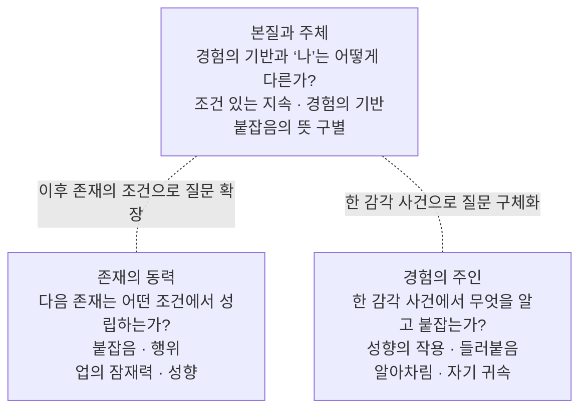
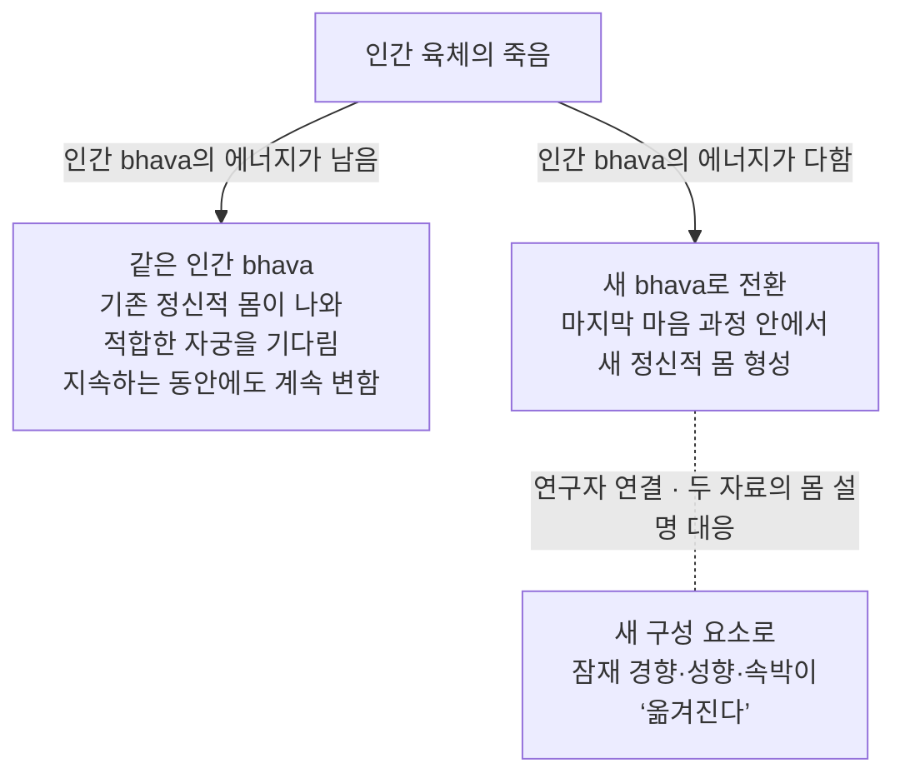
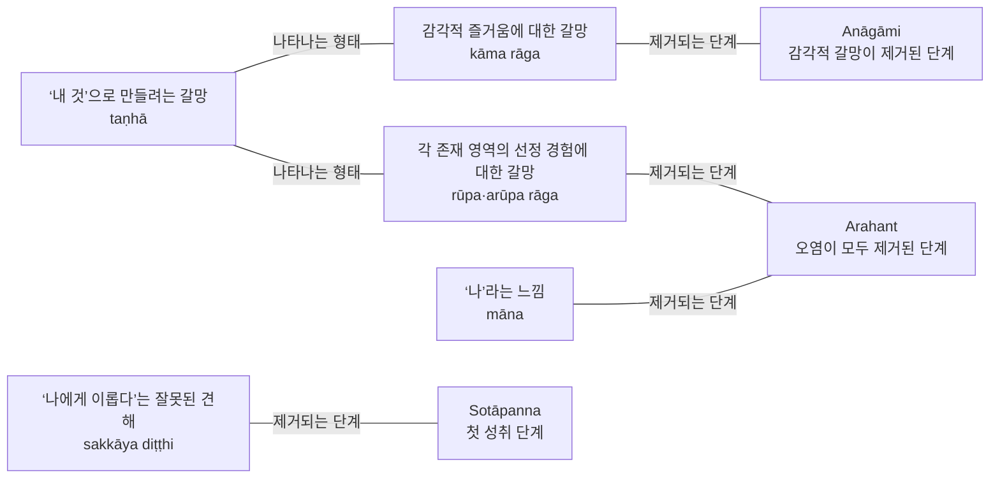
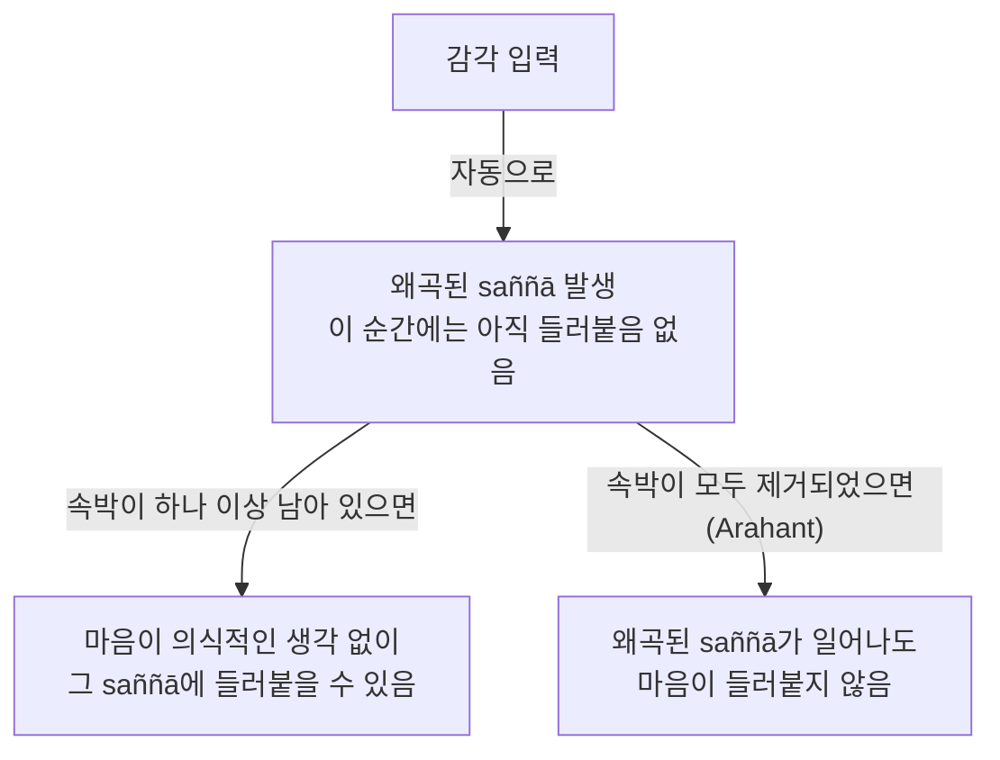

# 본질과 주체 — ‘인간의 본질’은 경험하는 주체인가

## §1. 요약

PD는 여러 글에서 인간의 정신적 몸인 gandhabba[인간의 감각·생각을 담당하는 미세한 몸], 또는 manomaya kāya[마음을 통해 만들어진 몸]를 ‘인간의 본질’이라고 부른다. 이 노트는 여러 자료를 함께 읽어, ‘본질’을 **육체와 구별되는 경험의 기반, 그리고 한 인간 bhava[인간으로 존재하는 기간] 안의 지속을 강조한 표현**으로 이해한다.[^uses][^duration] [[TLP-44_왜곡된 Saññā는 모든 성인에게 일어나지만 신생아에게는 일어나지 않는다]]는 독자를 정신적 몸과 동일시하고, [[AD-15_기계 속의 유령 – Manomaya Kāya의 동의어인가]]는 마음이 몸을 제어하는 주체라고 말한다. 이 두 표현은 그대로 두되, 변하지 않는 자아가 있다는 뜻으로 읽지는 않는다.[^agency]

정신적 몸은 한 bhava 안에서도 변하고, 새로운 bhava로 전환할 때에는 새로 형성된다(AD-15). 경험의 기반이 있다는 말은 변하지 않는 영혼이 있다는 뜻과 다르다.[^duration][^soul] 다만 [[BD-26_Anuseti – Anusaya가 Saṅkhāra와 함께 자라는 방식]]은 anusaya·gati·saṁyojana, 곧 잠재 경향·성향·속박이 새 몸으로 ‘옮겨진다’고 설명한다. 이 노트는 새 몸으로 이어진다는 설명을, 변하지 않는 영혼의 존속도 모든 인과적 이어짐의 단절도 아닌 조건에 따른 이어짐으로 이해할 수 있다고 본다.[^latent][^existence] 경험을 ‘내 것’으로 붙잡는 것, ‘나’라고 느끼는 것, 경험이 자신에게 이롭다고 보는 것도 서로 다르며, 제거되는 단계도 다르다.[^modes]

이렇게 나누어 보면 ‘본질’이라는 말에서 곧바로 고정된 자아를 떠올리는 독해를 피할 수 있다. 다만 ‘여섯 미세 요소’라는 설명과 육체를 따라 ‘확장되는 몸’이라는 설명이 세부적으로 어떻게 대응하는지, 한 감각 사건에서 ‘내 경험’이라고 자각하는 순간이 정확히 언제인지는 확정하지 않는다.[^structure][^modes]

### 세 노트가 나누어 묻는 것

이 노트는 경험의 기반과 경험을 붙잡는 작용을 구별한다. 이 구별에서 질문을 넓혀, 「존재의 동력」은 다음 존재가 성립하는 조건을 묻는다. 「경험의 주인」은 개별 경험을 어떻게 알아차리고 ‘내 경험’으로 여기는지 묻는다. **점선은 연구자가 연결한 질문의 관계**이며, 인과·시간 순서·상하 위계나 고정된 독서 순서가 아니다.[^t052-rel]

함께 읽기: [[Inquiry/Findings/R_존재의 동력|존재의 동력]] · [[Inquiry/Findings/R_경험의 주인|경험의 주인]]. 두 후속 노트를 하나의 연속 과정으로 잇거나, 한 노트의 결론을 다른 노트의 교리 근거로 쓰지 않는다.

## §2. 문제 설정

**PD가 gandhabba(manomaya kāya)를 ‘인간의 본질’이라 부를 때, 그것은 ‘경험하는 주체’의 어느 뜻을 담고 어느 뜻을 배제하는가?**

세부 물음은 다음과 같다.

1. 한 bhava 안의 지속·육체의 청사진·감각이 등록되는 자리 가운데 무엇이 ‘본질’이라는 표현을 뒷받침하는가.
2. 지속하는 것·경험의 기반·‘나’로 붙잡는 작용·변하지 않는 자아를 자료는 어떻게 구별하는가.
3. ‘본질’을 변하지 않는 자아로 읽을 가능성을 자료의 어떤 설명으로 제한할 수 있는가. 저자가 그 오해를 막으려는 의도를 직접 밝혔는지도 살핀다.

이 노트에서는 ‘경험하는 주체’라는 말에 담긴 여러 뜻을 나누어 살펴본다. gandhabba의 경전 근거 자체의 타당성, 임사 체험의 증거력, citta vīthi[감각 입력에 반응하는 연속된 마음 순간들]의 세부 기제와 무아 교리 전체는 이번 설명 범위 밖이다.

기존 [[이것은 나의 손이다 – 반의법 질문]]은 소유 감각을 다루지만 정신적 몸을 중심으로 묻지 않아 별개다. 후속 [[R_존재의 동력]]과 [[R_경험의 주인]]은 각각 존재의 지속과 개별 감각 경험의 작용을 살핀다.

## §3. 자료와 방법

[[ER-27_마음 – 생각은 ‘정신적 몸’에서 일어난다]]의 ‘본질’ 표현에서 출발해, 같은 용례를 쓰는 글과 정신적 몸의 생성·지속·감각 조건을 설명하는 글을 함께 읽었다. 이어 경험을 ‘내 것·나’와 연결하는 설명, 변하지 않는 자아에 관한 설명을 비교했다. 한국어 저장본을 기본으로 하고, 용어·조건·표현 차이가 판단에 영향을 주는 영어 문단을 대조했다. 실제 사용 자료와 판본은 §7에 모았다.

비교에서는 각 글의 직접 설명과 여러 글을 연결한 이 노트의 해석을 나누어 읽는다. 여기서 확인한 것은 현재 저장본의 용례다. 그 표현이 최초 게시일부터 유지됐는지는 이 비교로 알 수 없다. 경전 구절은 PD 저자의 인용·해설을 통해 읽었으며 경전 번역을 별도로 검증하지 않았다. 에세이 「사람은 무엇으로 사는가」는 질문의 계기만 공유하고 교리 근거로 사용하지 않았다.

## §4. 결과 — ‘본질’이 가리키는 기반과 조건

### 4.1 반복되는 용례와 육체의 역할

#### **‘본질’의 용례와 네 설명 초점**

[[DS-54_정신적 몸 대 육체]]·BD-26·[[PS-61_Jhāna에서 육체로부터 분리되는 Gandhabba(정신적 몸)]]·[[KDC-85_기억 기록 – 다섯 무더기의 결정적인 부분]]·TLP-44·ER-27은 정신적 몸을 인간 또는 살아 있는 존재의 ‘본질’, 혹은 ‘당신의 본질’이라고 부른다. 영어 표현은 서로 조금씩 다르지만, 육체·뇌와 정신적 몸을 구별하는 문맥은 공통된다. 이 노트는 이를 **육체와 비교해 정신적 몸의 역할을 강조한 표현**으로 읽는다.[^uses]

아래 표는 정신적 몸의 역할에 관한 설명을 연구자가 네 항목으로 정리한 것이다. 청사진에 관한 설명은 [[AD-31_뇌 – 마음과 몸 사이의 인터페이스]]와 AD-15에서 가져왔으며, ER-27의 직접 초점은 감각 정보·마음의 자리·뇌의 역할에 있다.[^basis][^blueprint]

| 설명의 초점 | 자료에서 확인한 내용 | 조건과 해석 범위 |
|---|---|---|
| 지속 | 인간 bhava 동안 정신적 몸이 지속하고, 그 안에서 여러 육체적 태어남이 가능하다.[^duration] | 그 bhava를 유지할 에너지가 남아 있을 때다. ‘수천 년’은 가능한 기간의 설명이며 모든 인간 bhava의 고정 수명이 아니다. |
| 생명·생성 | 정신적 몸은 kamma[의도적 행위]에 따른 에너지로 생기며, 생명을 지닌 특별한 미세 요소로 설명된다.[^life] | 생명의 생성 조건에 관한 PD 설명이다. 정신적 몸이 만들어졌다는 설명만으로, 그것이 변하지 않는 영혼이 아니라는 주장이 충분히 입증되는 것은 아니다.[^soul] |
| 감각·생각 | hadaya vatthu[생각이 일어나는 마음의 자리]에 감각 정보가 새겨지고 citta[개별 마음 순간]가 일어난다.[^basis] | 입력 경로와 육체 안팎의 조건을 구별해야 한다. |
| 육체의 청사진 | 정신적 몸에 육체의 청사진이 있고(AD-31), kamma에 따른 에너지가 청사진을 자동 준비한다(AD-15).[^blueprint] | ER-27은 청사진을 직접 언급하지 않는다. |

#### **동일시와 제어·변화 능력의 표현**

TLP-44의 ‘당신은 당신의 정신적 몸’이라는 말과 AD-15의 몸 제어 설명에는 경험의 기반이라는 뜻을 넘어서는 표현도 있다. gandhabba는 오랜 윤회에서 쌓은 습관인 gati[습관적 성향]와 āsava를 통해 고유성을 얻으며, 그 습관을 바꿀 힘이 있다(AD-15). **이 노트는 이런 동일시와 제어·변화 능력의 표현을 그대로 두되, 이를 불변하는 자아의 인정으로 읽지는 않는다.** AD-15의 영혼 부정과 [[SI-14_Yamaka Sutta (SN 22.85) – Arahant의 경지는 절멸이 아니라 괴로움의 끝이다]]의 관습적인 사람·변하는 다섯 무더기를 함께 읽은 판단이다. TLP-44 자체가 그 동일시를 ‘관습적 표현’이라고 명시한 것은 아니다.[^agency]

### 4.2 지속하지만 변하지 않는 몸은 아니다

아래 도식은 **재탄생이 이어지는 경우**에 AD-15가 설명한 두 조건을 보여 준다. 실선 화살표에는 전환 조건을 적었고, 화살촉 없는 점선에는 이 노트가 두 자료를 어떻게 연결했는지 적었다. 배치와 선 길이는 소요 시간을 나타내지 않는다.[^t052-a][^t052-a-link]

육체가 죽어도 인간 bhava를 위한 에너지가 남아 있으면 gandhabba가 나와 적합한 자궁을 기다리고, 그 에너지가 다하여 새 bhava로 전환할 때에는 기존 정신적 몸이 그대로 이어지는 것이 아니라 새 정신적 몸이 형성된다(AD-15).[^duration]

ER-27의 ‘새로운 정신적 몸은 생성될 수 없다’는 문장은 바로 뒤의 조건, 곧 **기존 것이 죽을 때에만 새 것이 존재하게 된다**는 말과 함께 읽어야 한다. 앞부분만으로 생기지도 변하지도 않는 실체를 말한다고 볼 근거는 없다. 정신적 몸이 변하지 않는 영혼이 아니며 한 bhava 안에서도 계속 변한다는 설명도 있다(AD-15). 두 글을 함께 읽은 이 노트의 판단으로는, 여기서 정신적 몸이 ‘죽는다’는 것은 같은 bhava 안에서 되풀이될 수 있는 육체의 죽음과 다르다.[^soul][^renewal]

새 hadaya vatthu와 pasāda rūpa[감각 정보를 받는 미세 요소]가 만들어질 때 anusaya[잠재된 오염 경향]·gati·saṁyojana[재탄생에 묶는 속박]가 새로 만들어진 마음의 자리와 감각 요소들로 ‘옮겨진다’(BD-26). 이 노트는 이를 SI-14의 ‘생명의 흐름’, 곧 다섯 무더기의 연속과 함께 읽어 조건에 따른 이어짐으로 이해할 수 있다고 본다. 새 몸이 형성된다고 모든 인과적 이어짐이 끊기는 것도, 변하지 않는 영혼이 그대로 존속하는 것도 아니라는 해석이다. 다만 두 글의 상세한 작용 방식까지 같다고 본 것은 아니다.[^latent][^existence] 도식의 점선은 BD-26의 새 구성 요소 한 벌과 AD-15의 새 정신적 몸을 대응시킨 것이다. 두 설명을 견주어 놓은 선이므로, 추가 시간 단계나 변하지 않는 영혼의 이동을 나타내지는 않는다.[^t052-a-link]

### 4.3 감각이 오는 경로와 생각이 일어나는 자리를 구별한다

#### **육체 안팎에서 감각이 작동하는 조건**

인간의 정신적 몸은 hadaya vatthu와 다섯 pasāda rūpa를 중심으로 설명된다. 그러나 다섯 요소를 가진 것과 다섯 감각이 언제나 모두 작동하는 것은 다르다. 육체 밖에서는 보고 들을 수 있지만 맛·냄새·감촉은 느낄 수 없고, 육체 안에서 보는 경우에는 눈·시신경·뇌를 거쳐 정보가 전달된다(TLP-44).[^input]

#### 마음 대상의 입력과 뇌의 역할

마음에 떠오르는 대상은 어떤 경로로 들어오는가. 마음 대상인 dhammā를 hadaya vatthu가 직접 감지하는 경우를 다른 다섯 감각 입력과 구별한다(BD-26). 그러므로 생각이 hadaya vatthu에서 일어난다는 설명을 모든 생각이 반드시 다섯 pasāda rūpa를 거친다는 뜻으로 읽을 수는 없다. 육체를 가진 경우 마음 대상의 정보는 뇌의 mana indriya[마음 대상의 입력을 중개하는 기능]를 거쳐 들어온다(AD-31). 두 설명의 세부 대응은 확정하지 않는다.[^input]

육체 안에서는 뇌의 도움 없이 생각할 수 없고(AD-15), 깊은 잠에서 citta가 생성되지 않는 상태도 있다(ER-27). 그러므로 ‘직접 감지’라는 말만으로 육체 안에서도 뇌가 불필요하다고 읽을 수는 없다. 생각이 일어나는 자리가 있다는 설명 역시 생각이 언제나 흐른다는 뜻은 아니다.[^input]

ER-27은 hadaya vatthu가 입력에 기초해 생각을 생성한다고까지 표현한다. 생각을 생성하는 작용을 설명한다고 해서, 변하지 않는 영혼이 있다는 뜻은 아니다. ‘사고하는 실체가 아니다’라는 한마디로 자료가 말한 작용까지 지울 수는 없다.[^basis][^soul]

## §5. 논의 — 경험의 기반을 ‘나’와 동일시할 수 있는가

### 5.1 이 노트가 구별하는 네 물음

| 물음 | 자료에서 확인한 답 | 넘어서지 말아야 할 범위 |
|---|---|---|
| ㉠ 육체적 태어남을 넘어 무엇이 지속하는가 | 한 인간 bhava 안에서 정신적 몸이 지속할 수 있다.[^duration] | 조건 있는 지속이다. 새 bhava의 새 몸과 잠재 경향의 옮겨짐은 §4.2에서 구별한다. |
| ㉡ 감각·생각의 기반은 무엇인가 | hadaya vatthu에서 생각이 일어난다고 설명한다.[^basis][^input] | 기반과 붙잡음은 다른 물음이지만, 잠재 경향도 hadaya vatthu와 결부된다(BD-26).[^latent] |
| ㉢ 경험을 어떻게 붙잡고 중요하게 여기는가 | ‘내 것’으로 만들려는 갈망·‘나’라는 느낌·이롭다는 견해를 구별한다.[^modes] | 서로 관련되지만 동일하지 않으며, 제거되는 성취 단계가 모두 같은 것은 아니다. |
| ㉣ 그 배후에 변하지 않는 영혼·자아가 있는가 | 정신적 몸을 변하지 않는 영혼과 구별하고, 변하지 않는 자아를 부정한다.[^soul][^existence] | ‘경험 자체가 없다’거나 모든 문맥의 attā가 똑같은 뜻이라는 결론은 아니다. |

이 노트는 같은 경험을 두고 무엇을 설명하려는지 분명히 드러내기 위해 네 물음을 구분했다. 감각 입력에 두는 중요성은 열 가지 saṁyojana가 결정하고(ER-27), anusaya·gati·saṁyojana는 hadaya vatthu와 결부된다(BD-26). 그 경향이 잠재된 상태와 조건에 의해 촉발되는 경우의 구별도 있다(BD-26). 따라서 경험의 기반과 붙잡음을 나누어 묻는다고 해서, ‘본질’과 오염이 서로 다른 장소에 있다는 뜻은 아니다.[^basis][^latent]

예를 들어, ‘소리를 듣는 경험은 무엇을 기반으로 일어나는가’와 ‘그 경험을 왜 내 것으로 붙잡는가’는 같은 경험을 두고도 서로 다른 것을 묻는 질문이다.

### 5.2 ‘내 것·나·이로움’은 하나의 고정 자아 주장이 아니다

#### 세 뜻과 제거 단계

[[ITS-02_‘Etaṁ Mama, Esohamasmi, Eso Me Attā’ti – Taṇhā, Māna, Diṭṭhi와의 관계]]는 세 구절을 다음과 같이 설명한다.[^modes]

- **etaṁ mama:** ‘내 것’으로 만들려는 taṇhā[갈망하며 들러붙음].
- **esohamasmi:** māna[‘나’라는 느낌].
- **eso me attā:** ‘나에게 결실 있고 이롭다’는 diṭṭhi[잘못된 견해].

마지막 구절의 attā는 이 문맥에서 이로움을 가리킨다. SI-14가 부정하는 변하지 않는 자아와는 뜻이 다르다.[^modes][^existence]

제거 단계도 다르다. sakkāya diṭṭhi[붙잡은 경험이 결실 있고 이롭다고 보는 견해]는 Sotāpanna[첫 성취 단계의 성자]에서 먼저 제거되고, 감각적 갈망은 Anāgāmi[감각 욕구 영역의 다섯 속박을 제거한 성자]에서, 남은 rūpa·arūpa rāga[각 존재 영역의 선정 경험에 대한 갈망]와 māna는 Arahant[오염을 모두 제거한 성자]에서 제거된다(ITS-02). 따라서 Sotāpanna 뒤에도 ‘내 것’으로 붙잡는 갈망과 ‘나’라는 느낌은 남아 있다.[^modes]

아래 대응도는 **ITS-02 §§12–14의 분류에 한정해** 세 뜻과 제거 단계를 모은 것이다. 화살촉 없는 실선은 선에 적힌 대로 갈망이 나타나는 형태 또는 제거되는 단계의 대응을 뜻한다. 한 감각 사건에서 각 작용이 일어나는 순서나 수행의 진행 경로를 나타내지는 않는다.[^modes-map]

첫 성취에서 제거되는 속박에는 위 설명에 나오지 않은 것들도 있다. sakkāya diṭṭhi와 연관된 vicikicchā·sīlabbata parāmāsa도 함께 제거된다(ITS-02). [[SI-35_Kāya는 대부분의 Suttās에서 Pañcupādānakkhandha Kāya다]]는 taṇhā를 kāma·bhava·vibhava taṇhā로 나누고, vibhava taṇhā를 uccheda diṭṭhi[절멸 견해]와 같다고 하며 Sotāpanna 단계에서 제거된다고 한다. 이 분류와 ITS-02의 kāma·rūpa·arūpa rāga 분류는 각각의 설명 문맥에서 읽어야 한다.[^modes]

#### 관계 설명만으로 발생 순서를 정할 수는 없다

갈망·‘나’라는 느낌·견해가 어떻게 관련되는지에 대해서도 자료마다 설명의 초점이 다르다. 갈망과 ‘나’라는 느낌을 잘못된 견해에 연결하고(ITS-02), 세 작용을 무지와 갈망에 연결한다(SI-35). [[TLP-82_Sakkāya Diṭṭhi – '세계의 결실 없는 성질을 보지 못함']]의 음주 비유는 해로움을 알아도 욕구가 남을 수 있음을 보여 준다. 이들 설명을 통해 견해와 감각적 갈망이 제거되는 단계가 다르다는 점은 알 수 있다. 그러나 이들 설명만으로 한 감각 사건 안의 작용들을 하나의 발생 순서로 정할 수는 없다.[^modes][^sakkaya]

Sotāpanna 단계는 anicca 성질이 dukkha로 이어진다는 이해만을 요구하고, anatta 성질은 Arahant 단계에서 이해한다(TLP-82). 같은 글에서 attato samanupassati는 ‘마음이 감각 입력에 두는 중요성’만을 가리키며, anatta 성질이 아니라 anicca 성질에 직접 연결된다. 한편 anatta 성질은 rūpaṁ attato samanupassati, 곧 마음이 감각 대상인 rūpa를 중요하게 여기는 것의 결과라고도 한다.[^sakkaya]

이 노트는 Sotāpanna와 Arahant 두 단계의 차이를 이해하는 내용의 차이로 읽으며, 고정된 자아의 유무를 지적으로 아는 시점의 차이로 읽지 않는다. 또한 그 글이 구분한 네 가지 들러붙음 수준은 감각 입력에 두는 중요성의 차이를 나타낸다. 이는 이 노트의 네 물음과는 별개다.[^sakkaya]

#### 한 감각 사건에서 확인된 순서와 남은 물음

시작 없이 이어지는 재탄생의 맥락에서 반복된 들러붙음이 ‘나’라는 느낌을 확립한다(ITS-02). 그것만으로 한 감각 사건에서 ‘내가 겪는다’고 자각하는 순간을 지정할 수 없다.[^modes]

[[KDC-59_Saññā – 그것이 실제로 뜻하는 것]]은 한 감각 사건에서 왜곡된 saññā[대상을 알아보게 하지만 실제 성질 그대로를 전하지 않는 인식]가 자동으로 일어나는 순간과 그 뒤의 들러붙음을 구별한다. 첫 순간에는 아직 들러붙음이 없으며, 속박이 남아 있으면 의식적인 생각 없이 들러붙을 수 있다. 아래 도식의 갈림은 의식적인 선택이 아니라 남아 있는 속박에 따른 차이다. 왜곡된 saññā 자체가 오염은 아니며, ‘들러붙을 수 있다’는 모든 경우에 반드시 일어난다는 뜻으로 읽지 않는다.[^t052-b]

실선 화살표는 자료가 설명한 진행과 조건별 차이를 나타내며, 선에 방식과 조건을 적었다.

> [!question] 미확인 — ‘내가 겪는다’고 자각하는 시점
> **위 순서는 확인되지만, ‘내 것·나’의 느낌이나 ‘내가 겪는다’는 자각이 자동 들러붙음과 같은 순간에 생기는지는 확인되지 않았다.** 전체 순서를 모른다는 유보가 아니라 자각 시점에 관한 유보다. 따라서 이 물음을 도식의 특정 단계에 연결하지 않았다.[^t052-b-unknown]

살아 있는 Arahant도 보고 들을 수 있지만 그것에 대한 upādāna[붙잡음]는 없고(SI-35), 왜곡된 saññā를 경험하지만 들러붙지 않는다(KDC-59). 자료가 뒷받침하는 답은 **‘보고 듣지만 붙잡지 않는다’**는 것이다. 이로부터 모든 뜻의 ‘주체’가 없다고 결론 내리지는 않는다.[^arahant] SI-35의 upādāna와 KDC-59의 들러붙음을 하나의 세부 단계로 대응시킨 것도 아니다.[^t052-b]

### 5.3 같은 설명으로 합칠 수 없는 부분

#### 미세 요소와 확장되는 몸의 대응

정신적 몸을 hadaya vatthu와 다섯 pasāda rūpa라는 미세한 요소로 설명하고(ER-27·BD-26·PS-61), 육체가 자랄 때 함께 ‘확장되는’ 정신적 몸과 그 몸의 ‘뇌’를 말한다(AD-31). 두 설명 모두 정신적 몸을 경험의 기반으로 제시한다. **미세 요소 묶음과 확장되는 몸의 세부 관계는 이번 자료만으로 확정하지 않는다.** 그렇다고 어느 쪽의 오류나 시기별 교리 변화로 판정하지도 않는다.[^structure]

큰 몸과 그 핵심 요소의 관계로 읽을 여지도 있다. 새 정신적 몸이 동물의 모습을 닮는 예를 들고(AD-15), 그 몸이 핵심 요소를 ‘지닌다’고 한다(KDC-85). 반대로 여섯 요소로만 이루어졌다고 하며(TLP-44) 원자보다 작다고 설명한다(ER-27).[^structure]

#### 다섯 무더기의 ‘존재’와 정신적 몸

SI-14의 ‘존재가 있다’는 말을 이 노트는 같은 글의 앞 문단이 말한 매 순간 변하는 다섯 무더기의 모음으로서의 존재로 읽는다. 영어의 ‘there is an existence’도 대조했으나 판단의 근거는 ‘existence’라는 낱말이 아니라 ‘매 순간’과 다섯 무더기 문맥이다. ‘존재’를 gandhabba 또는 hadaya vatthu 하나와 동일시하지 않은 것은 연구자의 문맥 판단이며, 다섯 무더기 설명과 정신적 몸 설명의 상세 대응은 별도 질문으로 남긴다.[^existence]

### 5.4 ‘본질’을 변화·생성 조건과 함께 읽어야 하는 이유

이 노트가 우려하는 오해는 ‘본질’이라는 말에서 변하지 않는 핵심을 떠올리는 독해다. 이는 이 표현을 읽을 때 생길 수 있는 문제에 대한 연구자의 판단이다.

AD-15는 정신적 몸이 영혼이 아니며 계속 변한다고 직접 말한다. 마음과 몸의 상호 의존, 이전 bhava의 마지막 마음 과정에 따른 생성도 설명한다. 이 설명들을 함께 읽으면 정신적 몸을 변하지 않는 것으로 해석하기 어렵다. 다만 저자가 그 오해를 막으려고 이 설명들을 제시했다고 단정할 근거는 없다. ER-27에는 영혼이 아니라는 직접 문장은 없어도 새 몸이 생기는 조건이 제시되어 있다.[^soul][^renewal]

**‘본질’의 뜻은 자료가 설명한 변화와 생성 조건 안에서 읽어야 한다.**

## §6. 결론과 남은 질문

이 노트는 ‘인간의 본질’이라는 표현을 정신적 몸의 조건 있는 지속과 감각·생각의 기반을 강조한 말로 읽는다. 자료에는 정신적 몸과 독자를 동일시하거나 마음이 몸을 제어한다고 말하는 대목도 있다. 그 대목들도 같은 읽기 안에 두며, 이 읽기에 불변하는 자아의 인정은 들어 있지 않다.[^agency][^duration][^soul]

이렇게 읽으면 ‘경험하는 주체’라는 한 말에 겹쳐 있던 물음이 나뉜다. 무엇이 지속하는지와 어디에서 경험이 일어나는지, 그 경험을 어떻게 붙잡는지와 변하지 않는 자아가 있는지는 서로 관련되지만 같은 물음은 아니다. 이 네 물음은 설명을 위해 연구자가 구분한 것이며, PD의 공식 분류는 아니다. 주체가 있는지 없는지는 ‘주체’가 어떤 뜻으로 쓰였는지에 따라 따로 물어야 한다.

‘본질’의 근거와 적용 범위는 설명할 수 있지만, 다음 관계는 더 살펴야 한다.

- 여섯 미세 요소와 확장되는 몸은 구조적으로 어떻게 대응하는가.
- 다섯 무더기를 통한 경험 설명과 정신적 몸에 관한 설명은 어디까지 서로 대응하는가.
- 개별 감각 사건에서 ‘내 경험’이라는 자각은 자동 들러붙음과 같은 순간에 생기는가, 다른 순간에 생기는가.

후속 노트는 이 질문을 이어 탐구할 수 있다.

## §7. 참고자료

- [[ER-27_마음 – 생각은 ‘정신적 몸’에서 일어난다]] §§1–4·6–9·12–13 · §§2–3·9·13 <small>(영문)</small> (r2026-11-01)
- [[DS-54_정신적 몸 대 육체]] §§1–4 · §2 <small>(영문)</small> (r2023-02-26)
- [[BD-26_Anuseti – Anusaya가 Saṅkhāra와 함께 자라는 방식]] §§10–12 · §§10–12 <small>(영문)</small> (r2026-07-15)
- [[PS-61_Jhāna에서 육체로부터 분리되는 Gandhabba(정신적 몸)]] 앞·뒤 §6 및 §7 · 앞·뒤 §6 <small>(영문)</small> (r2022-02-14)
- [[KDC-85_기억 기록 – 다섯 무더기의 결정적인 부분]] §§2–5 · §5 <small>(영문)</small> (r2022-09-10)
- [[TLP-44_왜곡된 Saññā는 모든 성인에게 일어나지만 신생아에게는 일어나지 않는다]] §§1–3 · §§2–3 <small>(영문)</small> (r2026-01-12)
- [[AD-15_기계 속의 유령 – Manomaya Kāya의 동의어인가]] §§1–6·8–12 · §§4·6·8–12 <small>(영문)</small> (r2019-07-14)
- [[AD-31_뇌 – 마음과 몸 사이의 인터페이스]] §§9–11 · §10 <small>(영문)</small> (r2026-03-29)
- [[SI-14_Yamaka Sutta (SN 22.85) – Arahant의 경지는 절멸이 아니라 괴로움의 끝이다]] §§6–9 · §§6·8 <small>(영문)</small> (r2022-08-29)
- [[SI-35_Kāya는 대부분의 Suttās에서 Pañcupādānakkhandha Kāya다]] §§3–6 (r2026-05-03)
- [[TLP-82_Sakkāya Diṭṭhi – '세계의 결실 없는 성질을 보지 못함']] §§9–13 · §§11–12 <small>(영문)</small> (r2026-03-21)
- [[ITS-02_‘Etaṁ Mama, Esohamasmi, Eso Me Attā’ti – Taṇhā, Māna, Diṭṭhi와의 관계]] §§12–14 · §§12–14 <small>(영문)</small> (r2026-08-22)
- [[KDC-38_Bhava와 Jāti – 존재 상태와 그 안에서의 탄생]] §§1–4 (r2023-07-04)
- [[KDC-59_Saññā – 그것이 실제로 뜻하는 것]] §§8–10 (r2026-08-26)

[^basis]: ER-27 §§3·13; DS-54 §§1–2; AD-15 §6. ER-27 §§3·13 <small>(영문)</small>도 대조했다.
[^uses]: DS-54 §2 (r2023-02-26); BD-26 §11 (r2026-07-15); PS-61 뒤쪽 §6 (r2022-02-14); KDC-85 §5 (r2022-09-10); TLP-44 §2 (r2026-01-12); ER-27 §13 (r2026-11-01). DS-54 §2·BD-26 §11·PS-61 뒤쪽 §6·KDC-85 §5·TLP-44 §2·ER-27 §13 <small>(영문)</small>. 날짜는 §7의 각 파일 속성·Source history 기준이다.
[^duration]: ER-27 §4 및 절 제목; TLP-44 §2; PS-61 뒤쪽 §6·§7; KDC-38 §1; AD-15 §§8–9·11. TLP-44 §2·AD-15 §§8–9·11 <small>(영문)</small>.
[^soul]: AD-15 §§4·11; AD-15 §§4·11 <small>(영문)</small>. 영혼 부정의 직접 근거는 §11이다.
[^modes]: ITS-02 §§12–14; ITS-02 §§12–14 <small>(영문)</small>; SI-35 §§5–6.
[^sakkaya]: TLP-82 §§9–13, 특히 §§10–12; TLP-82 §§11–12 <small>(영문)</small>. 경전 구절은 PD의 인용·해설을 통한 확인이다.
[^renewal]: ER-27 §3; ER-27 §3 <small>(영문)</small>. 본문 §5.4에서 글의 설명 범위를 비교할 때 참고한 위치는 ER-27 §1(예상 독자와 기본 개념을 설명하려는 목적), §§12–13(정신적 몸·육체·뇌의 역할)이다. 이 설명을 저자의 오해 방지 의도로 단정하지 않는다.
[^life]: PS-61 뒤쪽 §6, ‘Kammic 에너지가 Manomaya Kāya를 만든다’; PS-61 뒤쪽 §6, ‘Kammic Energy Creates the Manomaya Kāya’ <small>(영문)</small>. §6 중복 번호를 보존해 위치를 덧붙였다.
[^input]: ER-27 §§2–4·6–9·12–13; AD-15 §6; TLP-44 §§2–3; BD-26 §11; BD-26 §11 <small>(영문)</small>; AD-31 §§9–11.
[^structure]: ER-27 §§3·9; BD-26 §11·PS-61 뒤쪽 §6 대 AD-31 §10. 반대 방향의 표현은 AD-15 §9·KDC-85 §5, 여섯 요소 한정은 TLP-44 §3. ER-27 §§3·9·BD-26 §11·PS-61 뒤쪽 §6·AD-31 §10·AD-15 §9·KDC-85 §5·TLP-44 §3 <small>(영문)</small>. 설명 범위의 대응을 확정하지 못했다는 연구자 판단이다.
[^blueprint]: AD-31 §10; AD-31 §10 <small>(영문)</small>; AD-15 §10. ER-27 §13에는 청사진이 직접 언급되지 않는다.
[^arahant]: SI-35 §4; KDC-59 §§9–10. KDC-59 §8의 saññā·vedanā 설명도 읽었지만 SI-35 §4의 ‘마음이 일으키는 느낌’과의 상세 대응은 이번에 확정하지 않았다.
[^existence]: SI-14 §§6·8; SI-14 §§6·8 <small>(영문)</small>. §8만으로 ‘존재’를 별도 경험자로 읽지 않은 것은 §6과 연결한 문맥 판단이다.
[^agency]: TLP-44 §2; AD-15 §§4·12; SI-14 §6. TLP-44 §2·AD-15 §§4·12 <small>(영문)</small>. 표현 사이의 연결은 연구자 판단이다.
[^latent]: BD-26 §§10·12; BD-26 §§10·12 <small>(영문)</small>; AD-15 §12; ER-27 §13. 잠재·촉발과 새 몸으로의 이어짐을 구별했다.

[^t052-a]: AD-15 §§8–9·11; ER-27 §4. 육체의 죽음 때 인간 bhava의 에너지 잔존 여부에 따른 두 경우와 한 bhava 안의 변화를 설명한다. 이 노트 §4.2의 범위로 도식화했다.
[^t052-a-link]: BD-26 §12의 새 hadaya vatthu·pasāda rūpa와 잠재 경향의 ‘옮겨짐’; AD-15 §9의 새 정신적 몸 형성·§11의 영혼과의 구별. 두 설명을 연결한 것은 이 노트 §4.2의 연구자 종합이며, SI-14 §6의 생명 흐름과 상세 기제를 동일시한 것이 아니다.
[^t052-b]: KDC-59 §§9–10; 별도 설명으로 유지한 SI-35 §4; 이 노트 §5.2 뒷부분 및 각주 `arahant`. KDC-59 §10의 ‘들러붙을 수 있다’와 자동성·Arahant의 예외를 보존했다.
[^t052-b-unknown]: KDC-59 §§9–10; ITS-02 §12. 자각의 정확한 위치를 정하지 않은 것은 이 근거 범위에 관한 연구자의 판단이다.
[^t052-rel]: 세 연구노트의 질문 범위를 재배치한 연구자 안내다. 이 노트 §§1–2; [[Inquiry/Findings/R_존재의 동력]] §§1–2; [[Inquiry/Findings/R_경험의 주인]] §§1–2; [[Assets/attachments/t049-three-research-notes-guide.svg]]의 세 질문·연결선 설명(문단 번호 없음). 세 카드의 질문 문구는 기존 SVG의 요약을 따랐으며 원본 §2의 연구 질문을 그대로 인용한 것은 아니다. 새 교리 관계나 결론을 검증한 도식이 아니다.

[^modes-map]: ITS-02 §§12–14. 세 구절의 뜻은 §§12–13, taṇhā가 나타나는 형태와 각 작용의 제거 단계는 §14에 근거한다. 이 자료의 설명을 대응도로 정리한 것이며, SI-35의 다른 분류나 개별 감각 사건의 발생 순서를 합친 도식이 아니다.

